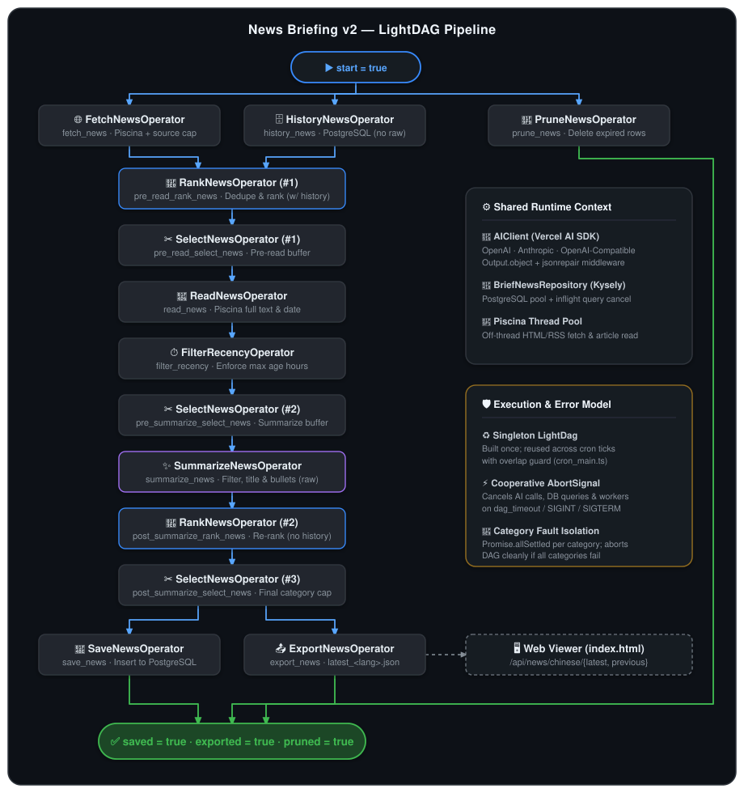

# News Briefing v2

An automated, AI-powered news ingestion, multi-stage ranking, summarization, and JSON publishing pipeline built with TypeScript, Node.js, [LightDAG](https://github.com/AnthonyChouGit/light_dag), Kysely (PostgreSQL), Piscina, and the Vercel AI SDK.

It periodically fetches news across curated categories, deduplicates and ranks stories against recent PostgreSQL history, scrapes full articles in parallel worker threads, synthesizes concise bulleted summaries with LLMs, exports atomic language-tagged JSON files (`latest_<language>.json` / `previous_<language>.json`), and includes a standalone [`index.html`](index.html) web reader.

## Architecture & Features

The pipeline is orchestrated by a singleton `LightDag` instance (`news_briefing_dag`) assembled once in [`src/dag.ts`](src/dag.ts) and reused across one-shot and scheduled cron runs.

<p align="center">
  
</p>

- **Consolidated Categories & Per-Source Limits:** Supports `international`, `china` (China domestic news verified for US accessibility: Global Times China, China Daily China, CGTN China, China News China/Finance, ECNS, BBC China), `philippines` (Philippine local & national news: Philstar, GMA News, Rappler, The Manila Times, BusinessWorld), `ai`, and focused `sports` (Football including Real Madrid, Formula 1, Baseball/MLB, and Table Tennis/WTT). Enforces configurable per-source caps (`fetch_max_items_per_source`, default `20`), Google News decode caps (`fetch_max_decode_items`), and canonical URL deduplication.
- **Two-Stage AI Ranking & Three-Stage Selection Funnel:** `pre_read_rank_news` filters ads, boilerplate, and duplicates (intra-batch and against PostgreSQL history) before `pre_read_select_news` limits scraping load. After full-text extraction and recency filtering, `pre_summarize_select_news` bounds LLM summarization costs, followed by `post_summarize_rank_news` and `post_summarize_select_news` to guarantee exact per-category output counts.
- **Lean AI Context (`raw` Isolated to Summarization):** [`BriefNewsRepository.findRecentByHours`](src/utils/db.ts) excludes stored `raw` bodies when loading history, and [`RankNewsOperator`](src/operators/rankNews.operator.ts) strips `raw` from AI ranking payloads so full article bodies are sent only during [`SummarizeNewsOperator`](src/operators/summarizeNews.operator.ts) and archived to PostgreSQL.
- **Parallel Off-Thread Scraping:** Dispatches RSS/HTML fetching (`_fetch.ts`) and full-text / publication-date extraction (`_read.ts`) to a [Piscina](https://github.com/piscinajs/piscina) worker pool with cooperative `AbortSignal` cancellation, followed by [`FilterRecencyOperator`](src/operators/filterRecency.operator.ts).
- **Unified Vercel AI SDK Client:** [`AIClient`](src/utils/ai.ts) integrates `@ai-sdk/openai`, `@ai-sdk/anthropic`, and `@ai-sdk/openai-compatible` with `Output.object` and `extractJsonMiddleware` (`jsonrepair`, `<think>` block stripping, and code-fence extraction) for reliable structured JSON across reasoning and non-reasoning models.
- **PostgreSQL Persistence & Maintenance:** Uses typed Kysely queries with in-flight query cancellation (`inflightQueryAbortStrategy: "cancel query"`), conflict-safe batch inserts (`save_news`), and scheduled retention cleanup (`prune_news`).
- **Atomic JSON Export & Web Reader:** [`ExportNewsOperator`](src/operators/exportNews.operator.ts) writes `<export_dir>/latest_<language>.json` via temp-file staging, rotates the prior issue to `previous_<language>.json`, and pairs cleanly with [`index.html`](index.html) (`/api/news/chinese/{latest,previous}`).
- **Singleton Cron & One-Shot Entrypoints:** [`cron_main.ts`](src/cron_main.ts) reuses the compiled `LightDag` across ticks with overlap protection, while [`main.ts`](src/main.ts) triggers an immediate single run.

## Quick Start

### 1. Clone & Configure

```bash
git clone <repo-url>
cd news_briefing_v2
cp example.env .env
```

Edit `.env` with your PostgreSQL credentials, AI provider key/model, active categories, and output limits.

> [!NOTE]
> Configuration loads from `./.env` by default (override via `CONFIG_PATH`). If `.env` is placed in `src/.env` or project root `.env` before building, `npm run build` automatically copies it into `build/.env`. Never commit `.env` or `test.env` (`*.env` is git-ignored).

#### Environment Variables

| Variable | Required | Default | Description |
| :--- | :---: | :---: | :--- |
| `db_host` | No | `localhost` | PostgreSQL hostname (`news_db` inside Docker Compose) |
| `db_port` | No | `5432` | PostgreSQL port |
| `db_user` | Yes | — | PostgreSQL username (also initializes `news_db`) |
| `db_password` | Yes | — | PostgreSQL password |
| `db_name` | Yes | — | PostgreSQL database name |
| `ai_api_key` | Yes | — | API key for OpenAI, Anthropic, or OpenAI-compatible provider |
| `ai_base_url` | Yes | — | Upstream API base URL (e.g. `https://api.openai.com/v1`) |
| `ai_model` | Yes | — | Model identifier (e.g. `gpt-4o-mini`, `beam-free`, `hy4-flash-free`) |
| `ai_provider_type` | Yes | — | `openai` (`/responses`), `anthropic` (`/messages`), or `openai-compatible` (`/chat/completions`) |
| `ai_reasoning_effort` | No | — | Reasoning effort: `low`, `medium`, `high`, `xhigh`, `max` (`medium` in `example.env`) |
| `ai_timeout` | No | `300000` | AI request timeout in milliseconds |
| `ai_max_retries` | No | `3` | Automatic retry count (`0` disables retries) |
| `ai_max_output_tokens` | No | `16384` | Max generated output tokens per request (`65536` in `example.env`) |
| `categories` | Yes | — | Comma-separated categories: `international, china, philippines, ai, sports` |
| `pre_read_select_count_by_category` | Yes | — | JSON map of max candidates per category before `read_news` |
| `pre_summarize_select_count_by_category` | Yes | — | JSON map of max candidates per category before `summarize_news` |
| `post_summarize_select_count_by_category` | Yes | — | JSON map of final items per category in exported briefing |
| `rank_keywords` | No | `[]` | Comma-separated or JSON array of interest keywords for mild ranking boost (e.g. `China`) |
| `rank_sports` | No | `[]` | Comma-separated or JSON array of target sports to keep and balance in `sports` (e.g. `Football, Baseball, Table Tennis, F1`) |
| `fetch_timeout` | No | `30000` | HTTP timeout (ms) for RSS/HTML fetching |
| `fetch_max_decode_items` | No | `5` | Max Google News redirect URLs decoded per feed (`10` in `example.env`) |
| `fetch_max_items_per_source` | No | `20` | Max news items retained per source or feed |
| `fetch_user_agent` | No | Chrome UA | Custom User-Agent header for feed fetching |
| `read_timeout` | No | `30000` | HTTP timeout (ms) for full-article scraping |
| `read_user_agent` | No | Chrome UA | Custom User-Agent header for article scraping |
| `read_max_body_chars` | No | Unlimited | Max retained `raw` article characters per item |
| `history_time_window_hours` | No | `72` | Lookback window (hours) queried by `history_news` |
| `prune_older_than_hours` | Yes | — | Retention threshold (hours); older DB records are pruned |
| `filter_recency_td_hours` | No | `24` | Max allowed article age (hours) in `filter_recency` |
| `language` | No | `English` | Target language (`English`, `Chinese`, `Spanish`, `French`, `German`, `Italian`, `Portuguese`, `Russian`, `Japanese`, `Korean`) |
| `summarize_min_chars` | Yes | — | Minimum character length per summary bullet |
| `summarize_max_chars` | Yes | — | Maximum character length per summary bullet |
| `summarize_min_bullets` | Yes | — | Minimum bullet points per summarized article |
| `summarize_max_bullets` | Yes | — | Maximum bullet points per summarized article |
| `export_dir` | Yes | — | Directory for `latest_<language>.json` & `previous_<language>.json` |
| `cron_expr` | For Cron | — | Standard 5-field cron schedule (e.g. `0 8,12,18,22 * * *`) |
| `time_zone` | No | System default | Timezone for cron schedule (e.g. `Asia/Shanghai`) |
| `dag_timeout` | No | Unlimited | Overall DAG execution timeout in milliseconds |
| `debug` | No | `false` | Enable verbose LightDAG topology & operator logs (`true`/`false`) |

### 2. Build & Launch with Docker Compose

#### Option A: One-Time Docker Build (No Local Node.js Required)

```bash
docker run --rm -v "$(pwd):/app" -w /app node:slim sh -c "npm ci && npm run build"
```

> [!TIP]
> On Windows PowerShell, replace `"$(pwd):/app"` with `"${PWD}:/app"`.

#### Option B: Local Node.js Build

```bash
npm ci
npm run build
```

Both options compile TypeScript into `build/dist/` and bundle `Dockerfile`, `docker-compose.yml`, `init.sql`, `run_once.sh`, `package.json`, `package-lock.json`, `example.env`, and `.env` (if present).

#### Launch Services

Start PostgreSQL (`news_db`, auto-initialized from [`init.sql`](init.sql)) and the scheduled cron service (`news_briefing`):

```bash
cd build
docker compose up -d --build
```

#### One-Shot Execution

Trigger an immediate single run (`node dist/main.js`) in an ephemeral container:

```bash
cd build
./run_once.sh
```

#### Manage & Monitor

```bash
docker compose logs -f news_briefing   # Application logs
docker compose logs -f news_db         # Database logs
docker compose down                    # Stop services
```

### 3. Export Format & Web Viewer

[`ExportNewsOperator`](src/operators/exportNews.operator.ts) outputs `<export_dir>/latest_<language>.json` without `raw` article bodies and rotates the previous file to `previous_<language>.json`:

```json
{
  "exported_at": "2026-11-17T15:49:35.719Z",
  "items": {
    "ai": [
      {
        "hash_id": "1c3d3bc2...",
        "url": "https://techcrunch.com/...",
        "title": "Localized headline",
        "source_date": "2026-11-17T14:05:30.000Z",
        "source_name": "TechCrunch",
        "category": "ai",
        "created_at": "2026-11-17T15:48:07.262Z",
        "bullets": [
          "Summary bullet 1...",
          "Summary bullet 2...",
          "Summary bullet 3..."
        ]
      }
    ]
  }
}
```

A lightweight, dependency-free static web viewer is provided at [`index.html`](index.html) (kept outside the backend `build/` bundle). Serve it behind your reverse proxy or API server exposing `/api/news/chinese/latest` and `/api/news/chinese/previous` — it defaults to `latest`, supports switching back and forth with `previous`, displays generation times for both versions, and gracefully shows **尚未生成** if an endpoint is unavailable.

## Developer Guide

### Project Structure

```
.
├── Dockerfile                         # Production container image (runs dist/cron_main.js)
├── docker-compose.yml                 # App + PostgreSQL 18 stack with healthchecks
├── init.sql                           # PostgreSQL brief_news table & index initialization
├── run_once.sh                        # One-shot Docker execution helper (dist/main.js)
├── example.env                        # Environment configuration template
├── index.html                         # Standalone web briefing viewer
├── package.json                       # Scripts & runtime dependencies
├── tsconfig.json                      # TypeScript compiler config (outDir: ./build/dist)
├── docs/
│   └── architecture.svg               # LightDAG pipeline architecture diagram
└── src/
    ├── config.ts                      # Unified Zod environment config loader
    ├── dag.ts                         # Explicit LightDag pipeline wiring & singleton
    ├── run.ts                         # Per-run DB/AI/Piscina resource lifecycle
    ├── main.ts                        # One-shot CLI entrypoint
    ├── cron_main.ts                   # Scheduled cron daemon (reuses DAG singleton)
    ├── utils/
    │   ├── ai.ts                      # Vercel AI SDK structured client & jsonrepair
    │   └── db.ts                      # Kysely PostgreSQL repository
    └── operators/
        ├── common/
        │   ├── BriefNews.schema.ts    # NewsCategory & BriefNews Zod schemas
        │   └── Language.schema.ts     # Supported output Language schema
        ├── worker/
        │   ├── _fetch.ts              # Off-thread HTML/RSS fetch & Google News decoder
        │   └── _read.ts               # Off-thread article content & timestamp extractor
        ├── fetchNews.operator.ts      # Concurrent multi-source ingestion
        ├── historyNews.operator.ts    # Recent DB history loader
        ├── pruneNews.operator.ts      # Expired DB record cleanup
        ├── rankNews.operator.ts       # AI quality filter, dedupe & ranking
        ├── selectNews.operator.ts     # Configured per-category top-N selector
        ├── readNews.operator.ts       # Full article body scraper wrapper
        ├── filterRecency.operator.ts  # Post-read publication timestamp cutoff filter
        ├── summarizeNews.operator.ts  # AI content quality check & bullet summarizer
        ├── saveNews.operator.ts       # Batch conflict-safe DB persistence
        └── exportNews.operator.ts     # Atomic JSON exporter with previous rotation
```

### Local Development Setup

#### Prerequisites
- **Node.js**: `>= 20.0.0`
- **PostgreSQL**: `>= 16`
- **AI API Key**: OpenAI, Anthropic, or OpenAI-compatible endpoint

#### Install Dependencies

```bash
npm ci
```

#### Run Locally

```bash
# Run one-shot briefing using ./test.env
npm test

# Run scheduled cron daemon using ./test.env
npm run test_cron

# Override configuration path
CONFIG_PATH=/path/to/custom.env npx tsx src/main.ts
```

#### Type Checking & Build

```bash
npx tsc --noEmit
npm run build
```

## License

ISC
