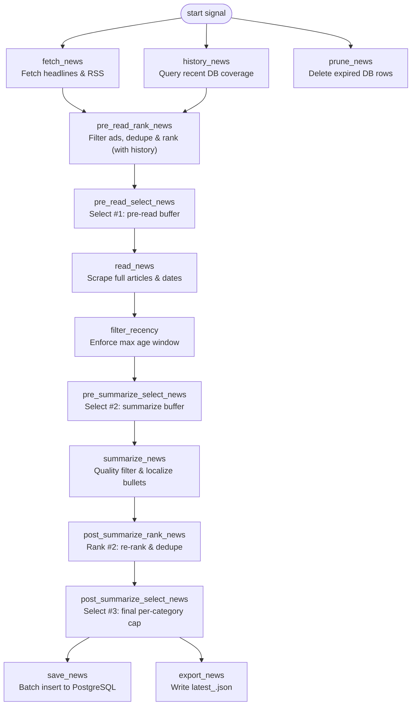

# News Briefing v2

An automated, AI-powered news ingestion, ranking, summarization, and JSON publishing pipeline built with TypeScript, Node.js, [LightDAG](https://github.com/AnthonyChouGit/light_dag), Kysely (PostgreSQL), Piscina, and the Vercel AI SDK.

---

## Architecture & Pipeline

The pipeline is orchestrated by a singleton `LightDag` instance (`news_briefing_dag`) assembled once in [`src/dag.ts`](src/dag.ts) and reused across one-shot and scheduled cron runs. Every node is a strongly-typed Zod-validated operator supporting unified LightDAG error handling and cooperative `AbortSignal` cancellation.



---

## Key Features

- **Consolidated Category Set (`international`, `domestic`, `ai`, `sports`)**: Unifies general sports (`BBC Sport`, `The Guardian`, `Google News Sports`) together with football, Real Madrid, Formula 1, MLB, and WTT feeds into a single `sports` category for cross-sport ranking and variety.
- **2-Stage AI Ranking + 3-Stage Selection Funnel**:
  - **Rank #1 (`pre_read_rank_news`)**: Filters advertisements, boilerplate, and low-value items; deduplicates intra-batch stories and removes/deprioritizes history duplicates (`history_items`); orders remaining candidates by importance, media authority, timeliness, topic diversity, and historical differentiation.
  - **Select #1 / #2 / #3**: Bounds scraping work before `read_news`, caps LLM summarization tokens before `summarize_news` while keeping backup candidates, and locks in the exact target counts per category after **Rank #2 (`post_summarize_rank_news`)**.
- **Parallel Off-Thread Scraping**: Runs feed parsing (`_fetch.ts`) and full-text / publication-date extraction (`_read.ts`) on a [Piscina](https://github.com/piscinajs/piscina) worker pool with `AbortSignal` propagation.
- **Unified AI SDK Structured Outputs**: [`AIClient`](src/utils/ai.ts) depends exclusively on the Vercel AI SDK (`@ai-sdk/openai`, `@ai-sdk/anthropic`, `@ai-sdk/openai-compatible`) paired with `Output.object` + `extractJsonMiddleware` (`jsonrepair`, `<think>` stripping, code-fence extraction) to guarantee valid schema-conforming JSON across all providers.
- **PostgreSQL Persistence & Auto-Pruning**: Uses typed Kysely queries ([`BriefNewsRepository`](src/utils/db.ts)) with PostgreSQL query cancellation (`inflightQueryAbortStrategy: "cancel query"`), batch conflict-safe inserts (`save_news`), and scheduled retention cleanup (`prune_news`).
- **Atomic Language-Tagged JSON Export**: [`ExportNewsOperator`](src/operators/exportNews.operator.ts) strips heavy `raw` bodies and writes concise summaries to `<export_dir>/latest_<language>.json`, atomically rotating any prior file to `previous_<language>.json`.
- **Zero-Rebuild Cron Daemon**: [`cron_main.ts`](src/cron_main.ts) initializes and configures `news_briefing_dag` once at startup, prevents overlapping ticks, and reuses the compiled graph on every schedule.

---

## Quick Start

### 1. Configure Environment

Copy [`example.env`](example.env) to `.env` (or `src/.env`) and fill in your credentials and limits:

```bash
cp example.env .env
```

> **Note**: Place `.env` in `src/.env` or project root `.env` before running `npm run build` to have it copied into `build/.env` automatically. Never commit `.env` or `test.env` (`*.env` is git-ignored).

#### Environment Variables Reference

| Variable | Required | Default | Description |
| :--- | :---: | :---: | :--- |
| `db_host` | No | `localhost` | PostgreSQL hostname (`news_db` inside Docker Compose) |
| `db_port` | No | `5432` | PostgreSQL port |
| `db_user` | Yes | — | PostgreSQL username (also used by `news_db` container) |
| `db_password` | Yes | — | PostgreSQL password |
| `db_name` | Yes | — | PostgreSQL database name |
| `ai_api_key` | Yes | — | API key for the configured AI provider |
| `ai_base_url` | Yes | — | Upstream API base URL (e.g. `https://api.openai.com/v1`) |
| `ai_model` | Yes | — | Model ID (e.g. `gpt-4o-mini`, `glm-5.3-flash`, `beam-free`) |
| `ai_provider_type` | Yes | — | `openai` (`/responses`), `anthropic` (`/messages`), or `openai-compatible` (`/chat/completions`) |
| `ai_reasoning_effort` | No | — | Reasoning effort when supported: `low`, `medium`, `high`, `xhigh`, `max` |
| `ai_timeout` | No | `300000` | AI request timeout in ms |
| `ai_max_retries` | No | `3` | Retry count (`0` disables retries) |
| `ai_max_output_tokens` | No | `16384` | Max generated output tokens per request |
| `categories` | Yes | — | Comma-separated active categories (`international, domestic, ai, sports`) |
| `pre_read_select_count_by_category` | Yes | — | JSON map of candidate caps per category before `read_news` |
| `pre_summarize_select_count_by_category` | Yes | — | JSON map of candidate caps per category before `summarize_news` |
| `post_summarize_select_count_by_category` | Yes | — | JSON map of final item counts per category in output |
| `fetch_timeout` | No | Worker default (`30000`) | HTTP timeout (ms) for feed/page fetching |
| `fetch_max_decode_items` | No | Worker default (`5`) | Max Google News redirect URLs decoded per feed |
| `fetch_user_agent` | No | Chrome UA | Custom User-Agent header for fetching |
| `read_timeout` | No | Worker default (`30000`) | HTTP timeout (ms) for article reading |
| `read_user_agent` | No | Chrome UA | Custom User-Agent header for article reading |
| `read_max_body_chars` | No | Unlimited | Max retained `raw` body characters per article |
| `history_time_window_hours` | No | `72` | Lookback window in hours for `history_news` |
| `prune_older_than_hours` | Yes | — | Retention age in hours; DB rows older than this are pruned |
| `filter_recency_td_hours` | No | `24` | Max article age in hours allowed by `filter_recency` |
| `language` | No | `English` | Target language (`English`, `Chinese`, `Spanish`, `French`, `German`, `Italian`, `Portuguese`, `Russian`, `Japanese`, `Korean`) |
| `summarize_min_chars` | Yes | — | Minimum character count per summary bullet |
| `summarize_max_chars` | Yes | — | Maximum character count per summary bullet |
| `summarize_min_bullets` | Yes | — | Minimum bullet points per summarized article |
| `summarize_max_bullets` | Yes | — | Maximum bullet points per summarized article |
| `export_dir` | Yes | — | Output directory for `latest_<language>.json` & `previous_<language>.json` |
| `cron_expr` | For Cron | — | Standard 5-field cron expression (e.g. `0 8,12,18,22 * * *`) |
| `time_zone` | No | System default | Timezone for cron schedule (e.g. `Asia/Shanghai`) |
| `dag_timeout` | No | Unlimited | Overall DAG execution timeout in ms |
| `debug` | No | `false` | Enable verbose LightDAG topology & per-operator logs |

---

### 2. Build & Deploy with Docker Compose

Build the TypeScript sources into `build/dist/` and bundle `package.json`, `package-lock.json`, `Dockerfile`, `docker-compose.yml`, `run_once.sh`, `init.sql`, `example.env`, and `.env` (if present):

```bash
npm ci
npm run build
```

> **No local Node.js?** Build inside a temporary Node container:
> ```bash
> docker run --rm -v "$(pwd):/app" -w /app node:slim sh -c "npm ci && npm run build"
> ```

Launch PostgreSQL (`news_db`, automatically initialized with [`init.sql`](init.sql)) and the scheduled cron service (`news_briefing`):

```bash
cd build
docker compose up -d --build
```

#### One-Shot Execution via Docker

Trigger an immediate single run using the bundled helper script (spins up an ephemeral container running `node dist/main.js`, reuses/starts `news_db`, and removes the container when done):

```bash
cd build
./run_once.sh
```

#### Monitoring & Shutdown

```bash
docker compose logs -f news_briefing
docker compose logs -f news_db
docker compose down
```

---

### 3. Local Development

Run directly with `tsx` against `test.env` (or override `CONFIG_PATH`):

```bash
# One-shot briefing run using ./test.env
npm test

# Scheduled cron daemon using ./test.env
npm run test_cron

# Custom env path
CONFIG_PATH=/path/to/custom.env npx tsx src/main.ts

# Type-check & build production bundle
npx tsc --noEmit
npm run build
```

---

## Exported JSON Format

[`ExportNewsOperator`](src/operators/exportNews.operator.ts) writes `<export_dir>/latest_<language>.json` (e.g., `latest_chinese.json`) without `raw` body text and rotates the previous file to `previous_<language>.json`:

```json
{
  "exported_at": "2026-11-17T15:49:35.719Z",
  "items": {
    "ai": [
      {
        "hash_id": "1c3d3bc2...",
        "url": "https://techcrunch.com/...",
        "title": "Headline in configured language",
        "source_date": "2026-11-17T14:05:30.000Z",
        "source_name": "TechCrunch",
        "category": "ai",
        "created_at": "2026-11-17T15:48:07.262Z",
        "bullets": [
          "Bullet point 1...",
          "Bullet point 2...",
          "Bullet point 3..."
        ]
      }
    ],
    "sports": []
  }
}
```

---

## Project Structure

```
.
├── Dockerfile                         # Production container image (runs dist/cron_main.js)
├── docker-compose.yml                 # App + Postgres 18 stack with healthchecks & volumes
├── init.sql                           # PostgreSQL table & index initialization
├── run_once.sh                        # One-shot Docker execution helper (dist/main.js)
├── example.env                        # Environment configuration template
├── package.json                       # Scripts & runtime dependencies
├── tsconfig.json                      # TypeScript compiler config (outDir: ./build/dist)
└── src/
    ├── config.ts                      # Unified Zod environment config loader
    ├── dag.ts                         # Explicit LightDag pipeline assembly & singleton export
    ├── run.ts                         # Per-run resource lifecycle & graceful signal handling
    ├── main.ts                        # One-shot CLI entrypoint
    ├── cron_main.ts                   # Scheduled cron daemon (builds DAG once)
    ├── utils/
    │   ├── ai.ts                      # Vercel AI SDK structured JSON client + repair middleware
    │   └── db.ts                      # Kysely PostgreSQL repository with AbortSignal support
    └── operators/
        ├── common/
        │   ├── BriefNews.schema.ts    # Core NewsCategory & BriefNews Zod schemas
        │   └── Language.schema.ts     # Supported output Language Zod schema
        ├── worker/
        │   ├── _fetch.ts              # Off-thread HTML/RSS fetch & Google News URL decoder
        │   └── _read.ts               # Off-thread article content & timestamp extractor
        ├── fetchNews.operator.ts      # Concurrent multi-source ingestion
        ├── historyNews.operator.ts    # Recent DB history loader
        ├── pruneNews.operator.ts      # Expired DB record cleanup
        ├── rankNews.operator.ts       # AI quality filter, dedupe & multi-criteria ranking
        ├── selectNews.operator.ts     # Configured per-category top-N selector
        ├── readNews.operator.ts       # Full article body scraper wrapper
        ├── filterRecency.operator.ts  # Post-read publication timestamp cutoff filter
        ├── summarizeNews.operator.ts  # AI content quality check & bullet summarizer
        ├── saveNews.operator.ts       # Batch conflict-safe DB persistence
        └── exportNews.operator.ts     # Atomic JSON exporter with previous file rotation
```

## License

ISC
